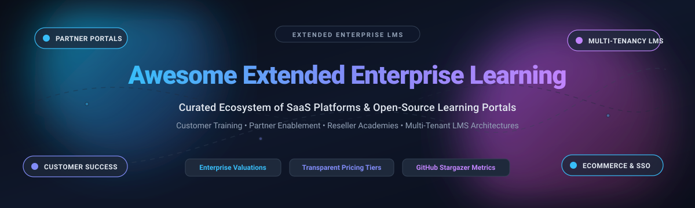
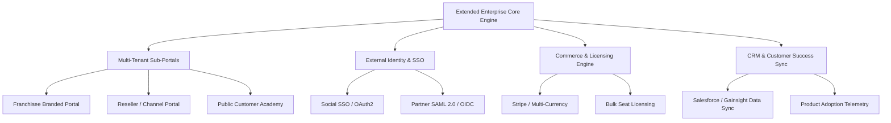

  

# 🎓 Awesome Extended Enterprise Learning

  
  
  
  

> 🌐 A curated collection of leading **Extended Enterprise Learning Management Systems (LMS)**, customer training portals, partner enablement software, and open-source multi-tenant educational platforms.

Extended Enterprise Learning represents training solutions targeted at external audiences—such as customers, channel partners, resellers, franchisees, contractors, and association members. These platforms accelerate user onboarding, boost product adoption, elevate partner retention, reduce support ticket volume, and drive recurring revenue through branded academies, multi-portal architectures, and integrated eCommerce. 🚀

---

## 📑 Table of Contents

- [📊 Sector Overview & Market Dynamics](#-sector-overview--market-dynamics)
- [🏢 SaaS & Hosted Enterprise Platforms](#-saas--hosted-enterprise-platforms)
- [💻 Open-Source GitHub Projects](#-open-source-github-projects)
- [🏗️ Architecture & Frameworks Comparison](#️-architecture--frameworks-comparison)
- [✅ Key Features Checklist for Extended Enterprise](#-key-features-checklist-for-extended-enterprise)
- [🤝 How to Contribute](#-how-to-contribute)
- [💖 Support](#-support)
- [⭐ Star History](#-star-history)
- [⚖️ Disclaimer & License Guidance](#️-disclaimer--license-guidance)

---

## 📊 Sector Overview & Market Dynamics

The global Learning Management System (LMS) market is estimated between **$24B and $34B** (scaling toward **$100B+** by the mid-2030s at an estimated **16%–22% CAGR**), with extended enterprise learning constituting one of its fastest-growing and highest-retention software segments. 📈

The sector is **moderately fragmented**: broad enterprise Human Capital Management (HCM) conglomerates (such as SAP and Workday) capture large-scale workforce consolidation deals, while specialized customer and partner education providers (such as Docebo, Thought Industries, and Skilljar) command dominant market share in external academies requiring dedicated multi-tenant branding, granular authorization, and direct CRM/eCommerce revenue attribution. 🎯

---

## 🏢 SaaS & Hosted Enterprise Platforms

The following table summarizes notable commercial SaaS platforms tailored for extended enterprise learning, partner training, and customer education. Platforms are sorted in descending order by parent company market capitalization / valuation.

| Platform | Company Valuation / Revenue | Starting Price (Entry Tier) | Free Tier / Free Trial Limits | Key Extended Enterprise Strengths |
| :--- | :--- | :--- | :--- | :--- |
| **[SAP Litmos](https://www.litmos.com/)** | ~$250B+ Market Cap *(SAP / Francisco Partners)* | **$8,000 / year** *(Foundation tier, ~100–150 users baseline)* | **14-day free trial** *(No credit card required; full admin and learner interface access)* | ⚡ Rapid-deployment cloud LMS with built-in eCommerce, off-the-shelf content catalogs, and external partner training. |
| **[Workday Extended Enterprise](https://www.workday.com/)** | ~$48B Market Cap | **~$100,000 / year** *(Mid-market/enterprise contract baseline, ~$50–$150/user/year)* | **No free trial for HCM core** *(Sales demo & guided scoping only; 30-day trial for Adaptive Planning module)* | 🏢 Unified human capital & finance ecosystem; white-labeled external worker portals tightly bound to HCM compliance records. |
| **[Cornerstone OnDemand](https://www.cornerstoneondemand.com/)** | ~$5.2B Valuation *(Clearlake Capital buyout)* | **~$22,000 / year** *(Modular entry baseline; typically $3.50–$8.00/user/month)* | **No free tier or trial** *(Sales-assisted POC and custom demo sandbox only)* | 🌐 Deep enterprise talent ecosystem offering scalable external portals for enterprise supply chains and distribution partners. |
| **[Canvas LMS](https://www.instructure.com/canvas)** *(Instructure)* | ~$4.8B Valuation *(KKR acquisition)* | **~$5,000 – $10,000 / year** *(Institutional baseline; ~$5–$30/student/year)* | **Canvas Free-for-Teacher** *(Freemium for individual educators; self-hosted open-source core is free forever)* | 🎒 Open-source core engine with vast LTI interoperability; widely adaptable for standardized external certifications and continuing education. |
| **[Docebo](https://www.docebo.com/)** | ~$750M Market Cap | **~$25,000 – $35,000 / year** *(AWS Marketplace / Elevate baseline for ~500 YAU)* | **No public self-serve free trial** *(Guided sales-led proof-of-concept and customized interactive demo only)* | 🤖 AI-powered learning platform with native multi-portal Extended Enterprise module, white-labeling, Salesforce integration, and Stripe checkout. |
| **[Absorb LMS](https://www.absorblms.com/)** | ~$500M+ Valuation *(WCAS acquisition)* | **~$14,500 / year** *(Mid-market baseline for ~500 learners via procurement data)* | **No self-serve free trial** *(Custom sandbox environments arranged via enterprise sales consultations)* | 🔄 Turnkey multi-tenant portals, automated learner workflows, and customizable eCommerce pipelines for external product education. |
| **[Skilljar](https://www.skilljar.com/)** *(Gainsight)* | ~$53M+ VC Funding / Scaled Division | **~$30,000 / year** *(Essentials tier baseline; scaled by Monthly Active Users)* | **No free trial** *(Sales consultation and customized sandbox demo for qualified buyer teams)* | 🎯 Purpose-built customer LMS by Gainsight; tight integrations with Salesforce, Gainsight CS, Marketo, Zendesk, and Stripe payment gateways. |
| **[LearnUpon](https://www.learnupon.com/)** | ~$57M+ Equity / $50M Growth Debt | **~$10,000 – $15,000 / year** *(Entry tier baseline, 100+ learner minimum)* | **No self-serve free trial** *(Direct sales walkthrough with scheduled sandbox testing)* | 🚪 Multi-portal architecture allowing distinct branded environments for employees, channel partners, and customers from one backend. |
| **[Thought Industries](https://www.thoughtindustries.com/)** | ~$50M+ Institutional Capital *(Luminate)* | **~$15,000 – $25,000 / year** *(Starter package; median contracts ~$54,000/year)* | **No free trial** *(Guided evaluation and bespoke proof-of-concept for enterprise buyers)* | 🏆 Craig Weiss #1 ranked Customer Training System; features Panorama multi-tenant portals, proctoring, ILT/vILT, and advanced licensing. |
| **[TalentLMS](https://www.talentlms.com/)** *(Epignosis)* | ~$20M – $40M Annual Revenue | **$1,428 / year** *($119/month billed annually for Core tier up to 40 users)* | **Free-forever tier** *(Up to 5 active users, 10 active courses, 100 MB file upload limit, no expiry)* | 💡 Accessible, easy-to-configure cloud LMS with branching portals (Branches feature on higher plans), eCommerce integration, and Gamification. |

---

## 💻 Open-Source GitHub Projects

The following table showcases open-source learning platforms and modular extensions suitable for external training, multi-tenancy, and customer enablement. Repositories are sorted in descending order by GitHub stargazer count.

| Project | GitHub_Stars | Primary License | Architecture & Extended Enterprise Capabilities |
| :--- | :---: | :--- | :--- |
| **[Open edX](https://github.com/openedx/edx-platform)** |  | AGPL-3.0 | 🌍 Massive-scale learning platform powering global MOOCs. Can be extended with [`eox-tenant`](https://github.com/eduNEXT/eox-tenant) for multi-tenancy microsites and branded catalogs across external partner cohorts. |
| **[Moodle](https://github.com/moodle/moodle)** |  | GPL-3.0 | 🎓 The world's most widely deployed open-source LMS. Combined with the [IOMAD](https://github.com/iomad/moodle-local_iomad) suite, it provides full multi-tenancy, per-company hierarchies, and tenant billing. |
| **[Canvas LMS](https://github.com/instructure/canvas-lms)** |  | AGPL-3.0 | 🎒 Ruby on Rails modern LMS core with comprehensive REST APIs and Canvas Studio/Catalog extensions for modular course delivery. |
| **[Frappe LMS](https://github.com/frappe/lms)** |  | AGPL-3.0 | ⚡ Modern, clean open-source LMS built on Python and Frappe Framework. Features native monetization, student certification, batch cohorts, and tight integration with ERPNext. |
| **[ClassroomIO](https://github.com/classroomio/classroomio)** |  | MIT | 🚀 Open-source no-code LMS built on SvelteKit and Supabase. Supports unlimited courses, AI-assisted authoring, and public-facing academies for independent educators and startups. |
| **[Chamilo LMS](https://github.com/chamilo/chamilo-lms)** |  | GPL-3.0 | 🛠️ Lightweight PHP-based e-learning suite supporting multi-institution setups, skills management, session-based training, and integrated eCommerce catalog extensions. |
| **[ILIAS](https://github.com/ILIAS-eLearning/ILIAS)** |  | GPL-3.0 | 🏛️ Mature enterprise learning platform compliant with SCORM and LTI. Includes integrated workspace management, fine-grained RBAC, and client separation capabilities. |
| **[Richie](https://github.com/openfun/richie)** |  | MIT | 🔍 Specialized Course Catalog CMS (Django/React) designed to sit in front of Open edX and Moodle instances to provide multi-site branded course discovery and sales portals. |
| **[IOMAD](https://github.com/iomad/iomad)** |  | GPL-3.0 | 🏢 Specialized enterprise distribution of Moodle built from the ground up for multi-tenancy: per-client sub-portals, custom themes, separate SSO configs, and per-tenant ecommerce gateways. |
| **[TutorLoom](https://github.com/pacewisdomhq/TutorLoom)** |  | Apache-2.0 | 🧩 Multi-tenant training platform built on Django and React with distinct trainer and student workflows, batch management, organizational divisions, and JWT authentication. |
| **[eox-tenant](https://github.com/eduNEXT/eox-tenant)** |  | AGPL-3.0 | 🌐 eduNEXT's flagship Open edX multi-tenancy plugin. Powers multi-organization microsites, custom URL routing, and scoped configurations across shared infrastructure. |
| **[euron-open-lms](https://github.com/euron-sde-team/euron-open-lms)** |  | Open-Source | 💳 Headless and self-hosted LMS emphasizing native payment integration (Stripe Checkout & Razorpay), public certificate verification links, HLS video delivery, and subscriptions. |

---

## 🏗️ Architecture & Frameworks Comparison

Extended enterprise applications have fundamental structural requirements that differ substantially from traditional internal HR learning systems:

### 🔍 Commercial vs. Open-Source Realities

1. **The Commercial Advantage (Turnkey CRM & Attributed ROI):** SaaS leaders like Skilljar, Thought Industries, and Docebo excel at deep integration with CRM pipelines (Salesforce, HubSpot, Gainsight). They correlate customer course completion with product retention, net revenue retention (NRR), and support deflection. 💼
2. **The Open-Source Multi-Tenancy Landscape:** True multi-tenancy is rare in vanilla open-source LMS projects. **Moodle + IOMAD** remains the most field-tested open-source option for corporate parent/child tenant hierarchies. **Open edX + eox-tenant** provides scalable MOOC infrastructure for large partner networks. 🔓
3. **Hybrid Architecture Approach:** High-scale training providers often combine an open-source course catalog portal (e.g., **Richie** or Headless Next.js/Frappe) with an isolated LMS execution backend to ensure optimal performance, white-labeled domain mapping, and data privacy compliance. 🚀

---

## ✅ Key Features Checklist for Extended Enterprise

When evaluating or architecting an extended enterprise LMS, verify support for the following critical capabilities:

- [x] 🏢 **Multi-Tenancy & White-Labeling:** Independent sub-domains, custom branding, localized CSS, and distinct email notification templates per tenant.
- [x] 🔐 **Federated Authentication:** Per-tenant SAML 2.0, OpenID Connect (OIDC), and social login (Google, GitHub, LinkedIn).
- [x] 👥 **Role-Based Delegation:** Delegated tenant administrators who manage their own user rosters and view scoped team compliance reports.
- [x] 💳 **Flexible eCommerce & Billing:** Native support for Stripe, PayPal, coupon engines, subscription billing, and bulk B2B license vouchers.
- [x] 📜 **Accreditation & Badging:** Verifiable digital certificates, Open Badges 2.0/3.0 compliance, and LinkedIn profile sharing.
- [x] 🔗 **API & CRM Integrations:** Bidirectional syncing with Salesforce, HubSpot, Segment, and Customer Success platforms.

---

## 🤝 How to Contribute

Contributions are warmly welcomed! Help us keep this ecosystem accurate and comprehensive. 🌟

1. **Fork the repository** on GitHub. 🍴
2. **Create a branch** for your feature or addition (`git checkout -b feature/add-new-lms`).
3. **Add verified entries** to `README.md` adhering to the established table formats (ensure accurate pricing, trial details, and company metrics).
4. **Test formatting & links** before committing.
5. **Open a Pull Request** with a concise description of your additions. 🚀

---

## 💖 Support

If you found this curated list helpful for your organization, learning infrastructure, or product research, please consider supporting the project:

- ⭐ **Star this repository** to help others discover it!
- 🍴 **Fork and share** with colleagues in Customer Education, Partner Enablement, and Product Operations.
- ☕ **Buy me a coffee / Sponsor**: Support ongoing maintenance, research, and curation on the [GitHub Sponsor Dashboard](https://github.com/sponsors/ishandutta2007).

Thank you for your generous encouragement and support! 🙏

---

## ⭐ Star History

---

## ⚖️ Disclaimer & License Guidance

- This repository is a community-maintained curated index provided for research, architectural planning, and educational purposes. 📚
- Extended enterprise platforms processing partner and customer data must strictly adhere to data protection regulations (GDPR, CCPA) and payment security standards (PCI-DSS). 🛡️
- Please verify software licensing terms before commercial deployment (GPL, AGPL, MIT, Apache-2.0, or proprietary terms). 📜

---

  <b>Built with ❤️ for Customer Education Leaders, Partner Enablement Managers, and Learning Architects.</b> 
  Star ⭐ this repo if you find it helpful for your learning ecosystem architecture!

